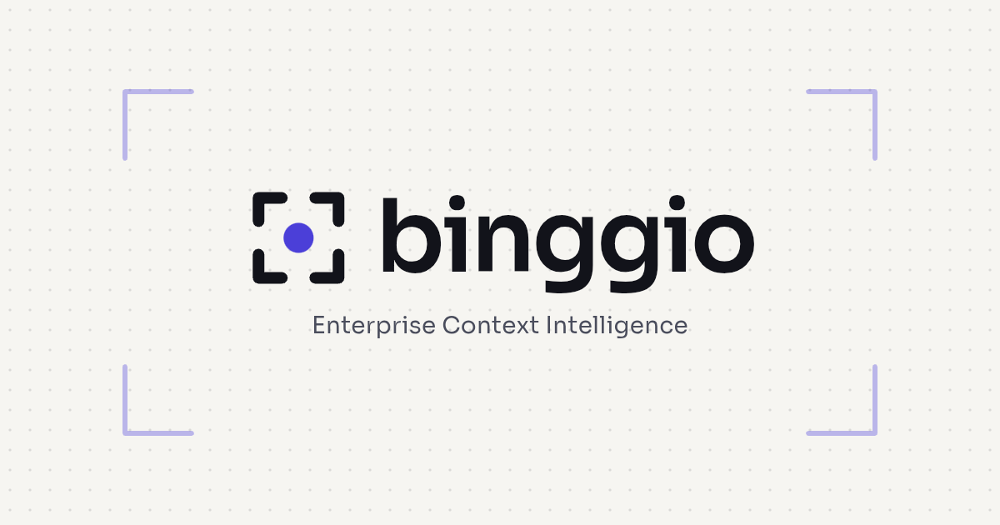

# Binggio™

<!-- mcp-name: com.binggio/binggio -->

**Governed answers from your data.** Binggio answers questions only from meanings a person has
approved: which column is a key, how tables link, what "delinquent" means. When it cannot answer
precisely it says why, instead of guessing.

- Works on your machine, with your files and databases. Nothing is written back to any source.
- Every answer shows the terms, filters, links and sources it used.
- Approvals are recorded with who made them and why, and stop being used the moment the data
  they were made on changes.

## Install

```bash
pip install binggio                 # CSV and SQLite
pip install binggio[excel]          # + Excel workbooks
pip install binggio[sqlserver]      # + SQL Server (no ODBC driver needed)
pip install binggio[oracle]         # + Oracle (no Oracle client needed)
pip install binggio[all]            # everything
```

If your terminal says `binggio` is not recognised (common on Windows when pip installs into the
user folder), use `python -m binggio` instead, for example `python -m binggio ui`, or add the
Scripts folder pip mentions to your PATH.

Asking questions in plain language needs a model key: set `BINGGIO_LLM_API_KEY` (or
`OPENAI_API_KEY`). Everything else (profiling, discovery, review, running saved plans) works
without one.

## The app

```bash
binggio ui
```

Opens Binggio in your browser: create the sample bank or your own workspace, add CSV files, Excel
workbooks or databases (with a folder picker and a "test connection" step), walk through
onboarding, approve, reject, revoke or reopen column roles, relationships, concepts and business
terms, see the relationship map, and ask questions with the provenance of every answer.

It runs on this computer only (127.0.0.1), needs no internet, and adds no dependencies. The page
carries a random session token so other web sites cannot use it. Database passwords and model keys
typed into it are kept in memory only, never written to disk. The sample bank includes ten
prepared questions that run without a model key. Options: `--port 8800`, `--no-browser`.

## Use Binggio from AI agents (MCP)

```bash
binggio -w C:\banks\my-bank mcp
```

Binggio speaks the Model Context Protocol, so Claude Desktop, Claude Code, Cursor, VS Code and agent
frameworks can use it as a tool. The agent turns the user's question into a plan using Binggio's
approved vocabulary; Binggio validates it and answers from approved meanings only, or refuses with
the reason. Agents can propose a meaning for a coded value, but only a person can approve it, in
the app. No SQL is accepted, nothing is written to your sources, and it runs on this computer.

| Tool | What it does |
| --- | --- |
| `describe_approved` | The approved tables, columns, links, business terms and concepts, and the plan format |
| `run_plan` | Validates and runs a plan; rows with sources, terms and as-of date, or a refusal with the reason |
| `ask` | Lets Binggio interpret the question itself (needs a model key) |
| `status` | What is approved, waiting for review, or stale |
| `propose_term` | Suggests what a coded value means; a person approves it in the app |

### Connect your AI client in one step

```bash
binggio connect claude-desktop -w C:\banks\my-bank      # or: cursor, vscode, claude-code
```

This adds Binggio to the client's settings and keeps everything already there (a dated backup is
saved first; if the file is not valid JSON, nothing is changed). Add `--print` to see the settings
without changing anything. Restart the client afterwards.

Other ways in:

- **Claude Desktop bundle:** download `binggio-<version>.mcpb` from the
  [releases page](https://github.com/binggio/binggio/releases) and open it; Claude Desktop asks for
  your workspace folder. Needs Python 3.10 or later installed.
- **Without installing anything first** (with [uv](https://docs.astral.sh/uv/)): command `uvx`,
  arguments `binggio mcp`, and the environment variable `BINGGIO_WORKSPACE` set to your workspace.
- **By hand:** `{"mcpServers": {"binggio": {"command": "python", "args": ["-m", "binggio", "-w", "C:\\banks\\my-bank", "mcp"]}}}`

Every command also reads the workspace from `BINGGIO_WORKSPACE` when `-w` is not given.

## Two-minute demo (command line)

```bash
binggio demo my-bank                 # a synthetic bank, already reviewed and approved
cd my-bank
binggio status
binggio ask "Which customers in the PREMIUM segment have a delinquent loan?"
binggio ask                          # a conversation: follow-ups like "which of these ..." work
```

## Your own data

```bash
binggio init my-data && cd my-data

binggio add-csv   "Core export"   C:\exports\core          # a folder of .csv files
binggio add-excel "Branch report" C:\reports\branches.xlsx # each sheet becomes a table
binggio add-db    "Core banking"  sqlserver --host dbserver --database core --user reader --schema dbo
binggio add-db    "Loans"         oracle    --host orahost  --database ORCLPDB1 --user reader --schema LOANS

binggio profile                      # what each column looks like
binggio discover                     # which tables link to which
binggio impact                       # how the new source fits what you already have
binggio onboard --by "Your Name"     # review: column roles, links, concepts, words for codes
binggio ask
```

`onboard` walks through four steps and records every decision under your name:

1. **Column roles**: keys, measures, dates, statuses. Suggestions are shown; you approve per table.
2. **Links**: which column points to which table, with the evidence (how many values match).
3. **Concepts**: names for the things in your data ("collection case", "collateral").
4. **Words for codes**: `kept = N` means "broken promise"; `status = W` means "written off".
   Questions can use those words only after you define them.

`binggio onboard --accept-suggestions --by "Your Name"` accepts all suggestions at once (still
recorded as your decision). It never approves a duplicate copy of an existing table, and leaves
weak alternative links for you to look at.

## What Binggio will not do

- **Guess a meaning.** A word with no approved meaning, or two approved meanings, is refused with
  the choices.
- **Answer from part of the data.** Answers read whole tables (up to 1,000,000 rows per table in
  this version). Longer result lists show the first 200 rows and say how many there are.
- **Change your data.** Databases are read with SELECT statements only; the copy lives in the
  workspace, and `binggio refresh <connection>` re-reads it in place.

Not yet supported, and refused with a clear message: ratios and shares, time windows relative to
today ("last 30 days"), durations, change over time, conditions on counts ("more than one
complaint").

## Python

```python
import binggio
ws = binggio.Workspace.create("my-data")
ws.add_excel("Branch report", r"C:\reports\branches.xlsx")
ws.profile(); ws.discover()
print(ws.status())
answer = ws.ask("What is the total balance of OPEN loans by branch?")
```

## Checking it on your own database

`tools/check_database.py` connects to a real SQL Server, Oracle or PostgreSQL database.
`--list` is read-only. `--cross-source` loads a small test bank into a scratch schema, checks
that it gives the same answers as the CSV copy, and removes it again.

## Status

0.1, early.

## Licence

Binggio is free software: you can redistribute it and/or modify it under the terms of the GNU
Affero General Public License as published by the Free Software Foundation, either version 3 of
the License, or (at your option) any later version. It is distributed in the hope that it will be
useful, but WITHOUT ANY WARRANTY; without even the implied warranty of MERCHANTABILITY or FITNESS
FOR A PARTICULAR PURPOSE. See the [LICENSE](LICENSE) file for details.

In short: use it freely, inside your organisation too. If you modify Binggio and let other people
use the modified version, including over a network, you must make your modified source code
available to them under the same licence.

**Trademark.** Binggio™ and the Binggio logo are trademarks of Ashish Kumar (applications filed in India). The
AGPL covers the code, not the name: forks are welcome under a different name. See
[TRADEMARKS.md](TRADEMARKS.md).

**Contact.** Feedback, questions, commercial licences, implementation and partnerships:
[ashish@binggio.com](mailto:ashish@binggio.com). Security issues: see [SECURITY.md](SECURITY.md).

**Commercial licence.** If the AGPL does not fit your organisation (for example, you want to embed
Binggio in a closed product or service), a commercial licence is available: see
[COMMERCIAL.md](COMMERCIAL.md).
